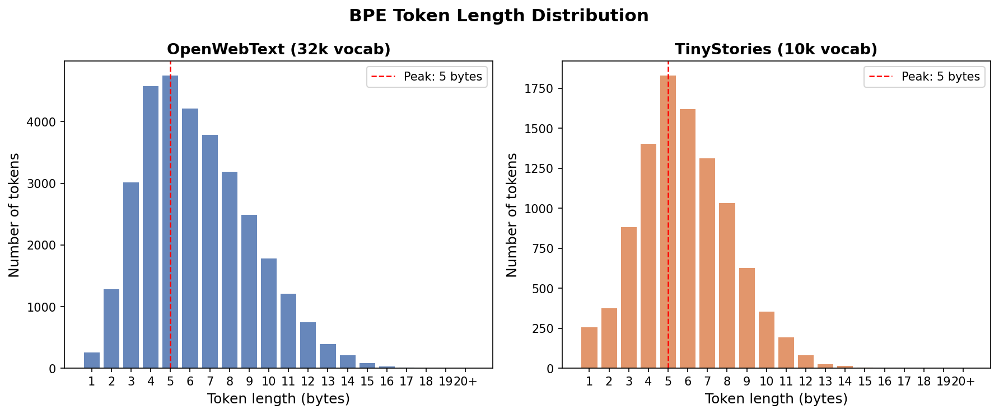
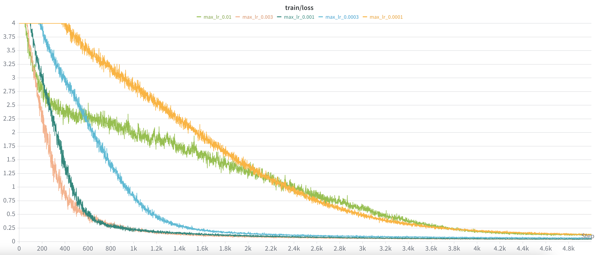
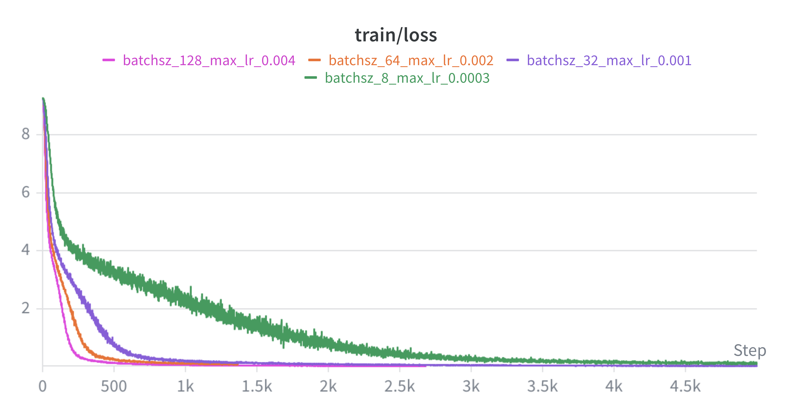
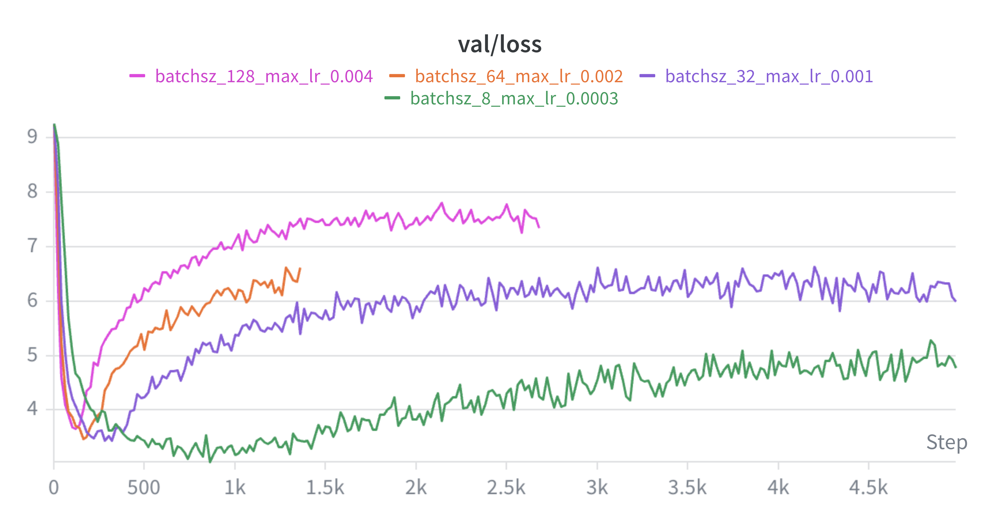
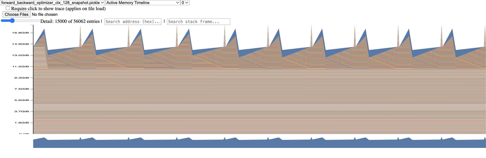
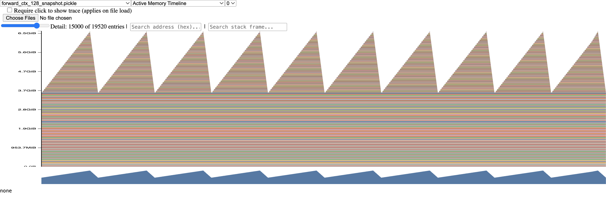

# CS336: Language Modeling from Scratch (Writeups)

## Assignment 1: Basics - Tokenizer, Transformer, Training

### Problem (unicode1)
```
>>> chr(0)
'\x00'
>>> repr(chr(0))
"'\\x00'"
>>> print(chr(0))

>>> "this is a test" + chr(0) + "string"
'this is a test\x00string'
>>> print("this is a test" + chr(0) + "string")
this is a teststring
```

(a) `chr(0)` returns the unicode character '\x00', which is 0.
(b) `repr(chr(0))` outputs a readable, escape-sequenced code "'\\x00'", whereas the printed representation is blank.
(c) If it's printed it's invisible, but it's visible when using repr().


### Problem (unicode2)
```
>>> test_string = "hello my name is michael"
>>> utf8_encoded = test_string.encode("utf-8")
>>> print(utf8_encoded)
b'hello my name is michael'
>>> utf16_encoded = test_string.encode("utf-16")
>>> utf32_encoded = test_string.encode("utf-32")
>>> len(list(utf8_encoded))
24
>>> len(list(utf16_encoded))
50
>>> len(list(utf32_encoded))
100
```
(a) UTF-8 encoded bytes is shorter / more compact.

(b) This treats each byte independently and tries to decode it as a full UTF-8 character. However, UTF-8 is variable-length encoding and one character could map to more than one byte.

```
>>> decode_utf8_bytes_to_str_wrong("你好".encode("utf-8"))
Traceback (most recent call last):
  File "<stdin>", line 1, in <module>
  File "<stdin>", line 2, in decode_utf8_bytes_to_str_wrong
UnicodeDecodeError: 'utf-8' codec can't decode byte 0xe4 in position 0: unexpected end of data
```

(c)  2-byte sequences must start with `110xxxxx`, so the sequence b'\x80\x80' would fail.
```
>>> b'\x80\x80'.decode("utf-8")
Traceback (most recent call last):
  File "<stdin>", line 1, in <module>
UnicodeDecodeError: 'utf-8' codec can't decode byte 0x80 in position 0: invalid start byte
```

### Problem (train_bpe_tinystories)

(a) It takes 5 minutes to run on CPU. The longest token in the vocab is b' accomplishment'.

(b) get_pair_to_merge function takes the most time (73% of total). It's called once per merge and each call iterates over all pairs.


### Problem (train_bpe_expts_owt)

(a) Training on 5000 documents took 28 minutes. The longest token in the vocabulary is '—————————————————————-' (length 64). From inspecting the file, seems like many documents are using '—————————————————————-' as visual separator.

(b) 69.6% of TinyStories tokens exist in OpenWebText's vocab, but only 21.7% of OpenWebText's vocab exist in TinyStories. This makes sense since OWT's tokenizer underwent 3.2x more merges so it learned more tokens that TinyStories didn't. And most TinyStories merges OWT also learned.
Both tokenizers peak at 5 bytes, but OWT has a heavier right tail with more tokens up to 13+ bytes.




### Problem (tokenizer_experiments)

(a) The compression ratio for the TinyStories tokenizer on 10 documents from TinyStories is 4.14.
The compression ratio for the OpenWebText tokenizer on 10 documents from OpenWebText is 4.43.

(b) OpenWebText with TinyStories tokenizer gets a compression ratio of 3.06. It gets a lower bytes/token ratio because the TinyStories tokenizer was trained less (underwent less merges), so it didn't learn many merges that OpenWebText did, thus it must split words more when operating on OpenWebText.

(c) The tokenizer took 5 minutes to tokenize the tinystories dataset (23.7 MB). 825,000 MB / 4.74 MB = 174,000 minutes = 121 days. So a really really long time on a single CPU without heap optimization.

(d) uint16 is more memory efficient and also fits the vocab size.


### Problem (transformer_accounting)

(a) vocab_size = 50,257, context_length = 1024, num_layers = 48, d_model = 1600, num_heads = 25, d_ff = 6400.

Parameters in embedding layer: 50,257 x 1600 = 80,411,200
Attention $W_Q$, $W_K$, $W_V$, $W_O$ all 1600 x 1600. 4(1600 x 1600) = 10,240,000
Feed-forward: 1600 x 6400 + 6400 x 1600 = 20,480,000
Total per transformer block is about: 10,240,000 + 20,480,000 = 30,720,000

Total is about: (48 x 30,720,000) + 80,411,200 = 1,554,971,200 =~ 1.5B parameters

(b)

Attention projections:
- $W_Q x$: (d x d)(T x d) = $2Td^2$
- $W_K x$: (d x d)(T x d) = $2Td^2$
- $W_V x$: (d x d)(T x d) = $2Td^2$
- $QK^T$: (T x d)(d x T) = $2T^2d$
- Attention weighted value: (T x T)(T x d) = $2T^2d$
- Output projection: (T x d)(d x d) = $2Td^2$

Altogether attention: $8Td^2$ + $4T^2d$

Feedforward:
- 1st layer: (T x d)(d x $d_{ff}$) = $2Tdd_{ff}$
- 2nd layer: (T x $d_{ff}$)($d_{ff}$ x d) = $2Tdd_{ff}$

Total = $4Tdd_{ff}$

Total per layer: $8Td^2$ + $4T^2d$ + $4Tdd_{ff}$

Total: L($8Td^2$ + $4T^2d$ + $4Tdd_{ff}$)

Plug in 48 for L, 1024 for T, 1600 for d, and 6400 for $d_{ff}$

Total FLOPs: 3.34 × $10^{12}$

(c) The sequence length is small relative to model width, so the FFN requires the most FLOPs, hence why we do MoE on the FFN sometimes!

(d)
Assuming standard GPT-2 configs where $d_{ff}$ = 4d_model,

GPT-2 small: num_layers = 12, d_model = 768, num_heads = 12, d_ff = 3072

12 (8 x 1024 x $768^{2}$ + 4 x $1024^{2}$ x 768 + 4 x 1024 x 768 x 3072) =~ 2.13 x $10^{11}$ FLOPs

GPT-2 large: num_layers = 36, d_model = 1280, num_heads = 20, d_ff = 5120

36 (8 x 1024 x $1280^{2}$ + 4 x $1024^{2}$ x 1280 + 4 x 1024 x 1280 x 5120) =~ 1.64 x $10^{12}$ FLOPs

As model size increases, the FFNs and linear projection layers take up proportionally more total FLOPs because they scale quadratically with d_model.

(e)

48 (8 x 16384 x $1600^{2}$ + 4 x $16384^{2}$ x 1600 + 4 x 16384 x 1600 x 6400)

The FLOPs become dominated by the attention score calculations since they scale quadratically with context length.


### Problem (adamwAccounting)

(a) Peak memory = parameters + activations + gradients + optimizer state


### Problem (learning_rate)

(a) 

Learning rate sweep over 1e-4, 3e-4, 1e-3, 3e-3, and 1e-2.

I mistakenly only logged the train loss at this step and not val loss. However, these were the results:

lr = 1e-4 -> loss = 0.13531 ppl = 1.14489
lr = 3e-4 -> loss = 0.0684 ppl = 1.0708
lr = 1e-3 -> loss = 0.03911 ppl = 1.03989
lr = 3e-3 -> loss = 0.04395 ppl = 1.0449
lr = 1e-2 -> loss = 0.1329 ppl = 1.1421

(b) Loss improves up to 1e-3 then degrades at 3e-3 and 1e-2, which seems to be the edge of stability.


### Problem (batch_size_experiment)




As seen from train/loss, larger batches converge faster because each step uses a more accurate gradient estimate. However, smaller batch sizes generalizes better despite noisier training. All runs overfit (as evident from the validation loss decreasing then increasing again) because I only used a subset of TinyStories due to CPU constraints. I stopped at a batch size of 128 before encountering OOM.

### Problem (generate)

Prompt: "Once upon a time"

Generation: ", there was a little girl named Lily. She loved to play with her toys and go on vacations with her family. One day, Lily's mom told her they couldn't go on vacation because they didn't have enough money. Lily was sad, but she understood.

Lily's dad worked hard every day, but they still couldn't afford a vacation. One day, Lily saw her dad cutting the grass in their yard. She asked if she could help, and her dad said yes. Lily worked hard and helped her dad finish cutting the grass.

After they finished, Lily's dad gave her some money for doing such a good job. Lily was so happy! She realized that working hard can help you get what you want, even if it's not a vacation. That was a harsh lesson, but Lily learned that hard work can pay off in the end.<|endoftext|>"


Observations: The output is surprisingly fluent. With a higher temperature, the generations are more varied - sometimes a story about Lily, other times stories about Timmy or some fish. When setting temperature closer to 0, the generations are mostly about Lily.


## Assignment 2: Systems (Benchmarking, Mixed Precision, FlashAttention, Distributed Training)

### Problem (benchmarking_script)

(a) Code in benchmark.py. Results in results/

(b) Forward + backward pass takes about 3x as long as forward only. The times are on the scale of 1/100 of a second to almost a second. The variability across the measurements is pretty small, stdev is often under 1% or only slightly above.

(c) With no warmup, the times are only slightly higher but the stdev is much larger. Potentially the first 1 or 2 steps there is a lot of kernel / caching work done and is much slower, therefore increasing the stdev. All steps after that benefit from the system having already warmed up.
With one warmup step, the variability is much lower but still slightly higher than 5 warmup steps. Also the mean times are very similar to 5 warmup steps. Could be that the first step handled much of the warmup but not all of it.

### Problem (nsys_profile)

Seems like LambdaLabs gpu instances currently don't support nsight profiling. So will skip for now.

### Problem (mixed_precision_accumulation)

```python
s = torch.tensor(0, dtype=torch.float32)
for i in range(1000):
    s += torch.tensor(0.01, dtype=torch.float32)
print(s)
```
Prints tensor(10.0001)

```python
s = torch.tensor(0, dtype=torch.float16)
for i in range(1000):
    s += torch.tensor(0.01, dtype=torch.float16)
print(s)
```
Prints tensor(9.9531, dtype=torch.float16)

```python
s = torch.tensor(0, dtype=torch.float32)
for i in range(1000):
    s += torch.tensor(0.01, dtype=torch.float16)
print(s)
```
Prints tensor(10.0021)

```python
s = torch.tensor(0, dtype=torch.float32)
for i in range(1000):
    x = torch.tensor(0.01, dtype=torch.float16)
    s += x.type(torch.float32)
print(s)
```
Prints tensor(10.0021)

fp32 for both the accumulator and incremental values performs best. The precision of the accumulator is more important than the precisions of each increment.

### Problem (benchmarking_mixed_precision)

(a)
```python
initial dtype: torch.float32
dtype after first FC layer: torch.float16
dtype after relu: torch.float16
dtype after layer norm: torch.float32
dtype of logits: torch.float16
output dtype: torch.float16
loss dtype: torch.float32
fc1.weight, param dtype: torch.float32, grad dtype: torch.float32
ln.weight, param dtype: torch.float32, grad dtype: torch.float32
ln.bias, param dtype: torch.float32, grad dtype: torch.float32
fc2.weight, param dtype: torch.float32, grad dtype: torch.float32
```

* the model's parameters are in float32
* the output of the first feed-forward layer is float16
* the output of layer norm is float32
* the model's predicted logits are float16
* the loss is in float32
* the model's gradients are in float32

(b) In fp16 mixed-precision training, the autocast library still enforces that layer norm is executed in full fp32 precision. This is because layer norm could struggle with numerical stability issues if executed in fp16, specifically when calculating the variance which requires many squaring operations. The $$\epsilon$$ also might not be able to be represented with float16.

Fp16 has more precision bits but less exponent bits, whereas bf16 has less precision bits but more exponent bits. Since bf16 has the same number of exponent bits as fp32, if using bf16 we do not need to treat layer norm differently, and we can run layer norm in bf16 format without needing to execute that step in fp32.


(c) Results in results/forward_backward_optimizer_mixed_precision.csv and results/forward_backward_with_optimizer.csv.

Mixed precision is consistently faster. For smaller models and smaller context lengths, mixed precision is only slightly faster (e.g., 0.066775 vs. 0.072913). For larger models and larger context lengths, mixed precision is much faster (e.g., 0.723469 vs. 0.388248).


### Problem (memory_profiling)

(a)
Full training step with context length 128


Forward only with context length 128


The forward only image has consistent sharp spikes then decreases. The sharp spikes are likely the forward passes. And since there is no backward pass, the activations are freed. For the full training step, the activations are not fully freed after each forward pass. Furthermore, there are some thin sharp spikes which could correspond to the optimizer steps.


(b) Peak memory usage of forward step by context length:
* 128: 6.6 GB
* 256: 10.3 GB
* 512: 19.8 GB

Full training step:
* 128: 18 GB

(c) Mixed-precision peak memory usage of forward step by context length:
* 128: 7.2 GB
* 256: 9.6 GB
* 512: 15.8 GB

Full training step:
* 128: 17.9 GB

Using mixed-precision can reduce memory usage at larger context lengths, but sometimes even increases memory usage at smaller context lengths. At larger context lengths, activation memory dominates so the memory savings from mixed-precision becomes significant. At smaller context lengths, the additional overhead from maintaining mixed-precision states and conversions can outweigh activation savings.

(d) For the model with context length 128, batch size of 4, and d_model = 1600:

* activation size = (B x T x d_model x bytes per element) / (1024^2)
* activation size = (4 x 128 x 1600 x 4) / (1024^2)
* activation size = 3.125 MiB

(e) When reducing detail to only 10%, the largest allocation is of size 80 MiB.
Looking at the stacktrace, it looks like the allocation comes from tensor division operations (div_Tensor, PyNumber_TrueDivide). These could be temporary tensors created during layer norm or attention scaling operations.


### Problem (pytorch_attention)

| d_model | seq_len | fwd_time (s) | bwd_time (s) | mem after fwd (MB) | status |
|---------|---------|--------------|--------------|---------------------|--------|
| 16      | 256     | 0.0325       | 0.0608       | 21.21               | OK     |
| 16      | 1024    | 0.0725       | 0.1672       | 84.84               | OK     |
| 16      | 4096    | 0.7568       | 1.8534       | 1070.63             | OK     |
| 16      | 8192    | 2.8289       | 6.8483       | 4205.00             | OK     |
| 16      | 16384   |              |              |                     | OOM    |
| 32      | 256     | 0.0309       | 0.0621       | 22.09               | OK     |
| 32      | 1024    | 0.0652       | 0.1617       | 88.34               | OK     |
| 32      | 4096    | 0.7833       | 1.8849       | 1084.63             | OK     |
| 32      | 8192    | 2.9185       | 6.9421       | 4233.00             | OK     |
| 32      | 16384   |              |              |                     | OOM    |
| 64      | 256     | 0.0309       | 0.0621       | 23.84               | OK     |
| 64      | 1024    | 0.0682       | 0.1657       | 95.34               | OK     |
| 64      | 4096    | 0.8284       | 1.9336       | 1112.63             | OK     |
| 64      | 8192    | 3.1000       | 7.1270       | 4289.00             | OK     |
| 64      | 16384   |              |              |                     | OOM    |
| 128     | 256     | 0.0309       | 0.0582       | 27.34               | OK     |
| 128     | 1024    | 0.0741       | 0.1726       | 109.34              | OK     |
| 128     | 4096    | 0.9141       | 2.0257       | 1168.63             | OK     |
| 128     | 8192    | 3.4436       | 7.4871       | 4401.00             | OK     |
| 128     | 16384   |              |              |                     | OOM    |

This was benchmarked on an A100 with 40GB RAM.
At smaller sequence lengths, the memory after forward grows linearly with sequence length, but at larger sequence lengths, the memory after forward grows much faster. So the relationship is likely O(seq_len^2). One way to eliminate this memory cost is to recompute the attention activations during backward instead of storing it, trading off extra compute for saved memory.

### Problem (torch_compile)

(a)
Benchmarked on A100 with 40GB RAM (same as above).

| d_model | seq_len | baseline fwd (s) | compile fwd (s) | baseline bwd (s) | compile bwd (s) | compiled mem after fwd (MB) |
|---------|---------|------------------|------------------|------------------|------------------|-------------------------------|
| 16      | 256     | 0.0325           | 0.0241           | 0.0608           | 0.0468           | 21.22                          |
| 16      | 1024    | 0.0725           | 0.0491           | 0.1672           | 0.1078           | 84.88                          |
| 16      | 4096    | 0.7568           | 0.4390           | 1.8534           | 1.0870           | 1070.75                        |
| 16      | 8192    | 2.8289           | 1.7051           | 6.8483           | 3.8852           | 4205.25                        |
| 16      | 16384   | OOM              | 5.7394           | OOM              | 15.5994          | 16714.25                       |
| 32      | 256     | 0.0309           | 0.0275           | 0.0621           | 0.0417           | 22.09                          |
| 32      | 1024    | 0.0652           | 0.0485           | 0.1617           | 0.1089           | 88.38                          |
| 32      | 4096    | 0.7833           | 0.5438           | 1.8849           | 1.1057           | 1084.75                        |
| 32      | 8192    | 2.9185           | 1.9516           | 6.9421           | 3.9803           | 4233.25                        |
| 32      | 16384   | OOM              | 6.2884           | OOM              | 15.9829          | 16770.25                       |
| 64      | 256     | 0.0309           | 0.0285           | 0.0621           | 0.0434           | 23.84                          |
| 64      | 1024    | 0.0682           | 0.0701           | 0.1657           | 0.1128           | 95.38                          |
| 64      | 4096    | 0.8284           | 0.5183           | 1.9336           | 1.1511           | 1112.75                        |
| 64      | 8192    | 3.1000           | 1.7442           | 7.1270           | 4.0755           | 4289.25                        |
| 64      | 16384   | OOM              | 7.0036           | OOM              | 16.7186          | 16882.25                       |
| 128     | 256     | 0.0309           | 0.0287           | 0.0582           | 0.0456           | 27.34                          |
| 128     | 1024    | 0.0741           | 0.0763           | 0.1726           | 0.1218           | 109.38                         |
| 128     | 4096    | 0.9141           | 0.6079           | 2.0257           | 1.2495           | 1168.75                        |
| 128     | 8192    | 3.4436           | 2.0895           | 7.4871           | 4.4394           | 4401.25                        |
| 128     | 16384   | OOM              | 8.3827           | OOM              | 18.1259          | 17106.25                       |


(b)

Full end-to-end training step (forward + backward + optimizer step), baseline vs. torch.compile

| d_model | context_length | baseline mean_time (s) | compiled mean_time (s) |
|---------|-----------------|-------------------------|--------------------------|
| 768     | 128             | 0.072913                | 0.064861                 |
| 768     | 256             | 0.120324                | 0.100844                 |
| 768     | 512             | 0.241405                | 0.189355                 |
| 1024    | 128             | 0.219400                | 0.201784                 |
| 1024    | 256             | 0.369397                | 0.320342                 |
| 1024    | 512             | 0.723469                | 0.581659                 |
| 1280    | 128             | 0.518490                | 0.487466                 |
| 1280    | 256             | OOM                     | 0.750421                 |
| 1280    | 512             | OOM                     | OOM                       |
| 1600    | 128             | OOM                     | OOM                       |
| 1600    | 256             | OOM                     | OOM                       |
| 1600    | 512             | OOM                     | OOM                       |
| 2560    | 128             | OOM                     | OOM                       |
| 2560    | 256             | OOM                     | OOM                       |
| 2560    | 512             | OOM                     | OOM                       |


### Problem (flash_forward and flash_backward)

Key learnings:

* Q tile size equates to how many rows of Q are processed by a single thread block. Each GPU thread block is assigned to one tile of Q_TILE_SIZE query rows at a time.
* Online softmax rescales previously-accumulated partial results whenever a new larger max is seen. This avoids having to materialize entire row in memory at once.
* Mixed precision requires careful dtype management: when benchmarking with bf16, the intermediate accumulators are still kept in fp32 for numerical stability. However, they must explicitly be cast down before matmuls with lower precision elements. This was the cause of some "block element type(bf16) and value element type(fp32) mismatch" errors.


### Problem (flash_benchmarking)

Benchmarked on H100 with 80GB SXM5.

| seq_len | d_model | precision | pytorch_fwd (ms) | flash_fwd (ms) | fwd_speedup | pytorch_fwd_bwd (ms) | flash_fwd_bwd (ms) | fwd_bwd_speedup | status |
|---------|---------|-----------|------------------|-----------------|-------------|------------------------|----------------------|-------------------|--------|
| 128     | 16      | bf16      | 0.0751           | 0.0074          | 10.13       | 0.4959                 | 0.3161               | 1.57              | OK     |
| 128     | 16      | fp32      | 0.0718           | 0.0077          | 9.26        | 0.4945                 | 0.3290               | 1.50              | OK     |
| 128     | 32      | bf16      | 0.0922           | 0.0090          | 10.30       | 0.5200                 | 0.3387               | 1.54              | OK     |
| 128     | 32      | fp32      | 0.0934           | 0.0094          | 9.98        | 0.5683                 | 0.3462               | 1.64              | OK     |
| 128     | 64      | bf16      | 0.0936           | 0.0094          | 9.93        | 0.5214                 | 0.3292               | 1.58              | OK     |
| 128     | 64      | fp32      | 0.0908           | 0.0103          | 8.82        | 0.5124                 | 0.3365               | 1.52              | OK     |
| 128     | 128     | bf16      | 0.0923           | 0.0100          | 9.20        | 0.5297                 | 0.3362               | 1.58              | OK     |
| 128     | 128     | fp32      | 0.0962           | 0.0124          | 7.77        | 0.5424                 | 0.3602               | 1.51              | OK     |
| 256     | 16      | bf16      | 0.1007           | 0.0097          | 10.43       | 0.5454                 | 0.3555               | 1.53              | OK     |
| 256     | 16      | fp32      | 0.1069           | 0.0103          | 10.39       | 0.5652                 | 0.3732               | 1.51              | OK     |
| 256     | 32      | bf16      | 0.1051           | 0.0119          | 8.87        | 0.5520                 | 0.3406               | 1.62              | OK     |
| 256     | 32      | fp32      | 0.1081           | 0.0133          | 8.13        | 0.5743                 | 0.3554               | 1.62              | OK     |
| 256     | 64      | bf16      | 0.1004           | 0.0129          | 7.79        | 0.5456                 | 0.3497               | 1.56              | OK     |
| 256     | 64      | fp32      | 0.1060           | 0.0143          | 7.40        | 0.5657                 | 0.3500               | 1.62              | OK     |
| 256     | 128     | bf16      | 0.1009           | 0.0154          | 6.54        | 0.5525                 | 0.3434               | 1.61              | OK     |
| 256     | 128     | fp32      | 0.1063           | 0.0197          | 5.40        | 0.5725                 | 0.3583               | 1.60              | OK     |
| 512     | 16      | bf16      | 0.1024           | 0.0150          | 6.85        | 0.5572                 | 0.3773               | 1.48              | OK     |
| 512     | 16      | fp32      | 0.1106           | 0.0162          | 6.83        | 0.6050                 | 0.3907               | 1.55              | OK     |
| 512     | 32      | bf16      | 0.1063           | 0.0190          | 5.61        | 0.5674                 | 0.3402               | 1.67              | OK     |
| 512     | 32      | fp32      | 0.1089           | 0.0213          | 5.12        | 0.5712                 | 0.3506               | 1.63              | OK     |
| 512     | 64      | bf16      | 0.1028           | 0.0210          | 4.91        | 0.5497                 | 0.3434               | 1.60              | OK     |
| 512     | 64      | fp32      | 0.1082           | 0.0238          | 4.55        | 0.5742                 | 0.3540               | 1.62              | OK     |
| 512     | 128     | bf16      | 0.1060           | 0.0249          | 4.26        | 0.5462                 | 0.3427               | 1.59              | OK     |
| 512     | 128     | fp32      | 0.1085           | 0.0337          | 3.22        | 0.5743                 | 0.3574               | 1.61              | OK     |
| 1024    | 16      | bf16      | 0.1093           | 0.0199          | 5.50        | 0.5642                 | 0.3556               | 1.59              | OK     |
| 1024    | 16      | fp32      | 0.1131           | 0.0278          | 4.07        | 0.5871                 | 0.3764               | 1.56              | OK     |
| 1024    | 32      | bf16      | 0.1081           | 0.0331          | 3.26        | 0.5390                 | 0.3380               | 1.59              | OK     |
| 1024    | 32      | fp32      | 0.1080           | 0.0368          | 2.94        | 0.5570                 | 0.3457               | 1.61              | OK     |
| 1024    | 64      | bf16      | 0.1043           | 0.0371          | 2.81        | 0.5406                 | 0.3365               | 1.61              | OK     |
| 1024    | 64      | fp32      | 0.1084           | 0.0429          | 2.52        | 0.5600                 | 0.3511               | 1.60              | OK     |
| 1024    | 128     | bf16      | 0.1055           | 0.0445          | 2.37        | 0.5525                 | 0.3487               | 1.58              | OK     |
| 1024    | 128     | fp32      | 0.1119           | 0.0612          | 1.83        | 0.6097                 | 0.3709               | 1.64              | OK     |
| 2048    | 16      | bf16      | 0.1074           | 0.0441          | 2.43        | 0.5681                 | 0.3502               | 1.62              | OK     |
| 2048    | 16      | fp32      | 0.1103           | 0.0531          | 2.08        | 0.5601                 | 0.3496               | 1.60              | OK     |
| 2048    | 32      | bf16      | 0.1046           | 0.0624          | 1.68        | 0.5364                 | 0.3369               | 1.59              | OK     |
| 2048    | 32      | fp32      | 0.1104           | 0.0691          | 1.60        | 0.5595                 | 0.3474               | 1.61              | OK     |
| 2048    | 64      | bf16      | 0.1040           | 0.0701          | 1.48        | 0.5496                 | 0.3513               | 1.56              | OK     |
| 2048    | 64      | fp32      | 0.1075           | 0.0799          | 1.34        | 0.5687                 | 0.3543               | 1.61              | OK     |
| 2048    | 128     | bf16      | 0.1056           | 0.0848          | 1.24        | 0.5552                 | 0.3512               | 1.58              | OK     |
| 2048    | 128     | fp32      | 0.1122           | 0.1170          | 0.96        | 0.5849                 | 0.3745               | 1.56              | OK     |
| 4096    | 16      | bf16      | 0.2021           | 0.0866          | 2.33        | 0.5897                 | 0.3625               | 1.63              | OK     |
| 4096    | 16      | fp32      | 0.3033           | 0.1059          | 2.87        | 0.7928                 | 0.4583               | 1.73              | OK     |
| 4096    | 32      | bf16      | 0.2001           | 0.1243          | 1.61        | 0.5751                 | 0.3558               | 1.62              | OK     |
| 4096    | 32      | fp32      | 0.3181           | 0.1500          | 2.12        | 0.8230                 | 0.5325               | 1.55              | OK     |
| 4096    | 64      | bf16      | 0.1987           | 0.1479          | 1.34        | 0.5777                 | 0.3732               | 1.55              | OK     |
| 4096    | 64      | fp32      | 0.3525           | 0.1899          | 1.86        | 0.9318                 | 0.6668               | 1.40              | OK     |
| 4096    | 128     | bf16      | 0.2012           | 0.1961          | 1.03        | 0.6243                 | 0.4256               | 1.47              | OK     |
| 4096    | 128     | fp32      | 0.4368           | 0.2882          | 1.52        | 1.1829                 | 0.9860               | 1.20              | OK     |
| 8192    | 16      | bf16      | 0.7452           | 0.2631          | 2.83        | 1.8050                 | 0.9943               | 1.82              | OK     |
| 8192    | 16      | fp32      | 1.0677           | 0.3449          | 3.10        | 2.6674                 | 1.5198               | 1.76              | OK     |
| 8192    | 32      | bf16      | 0.7441           | 0.3469          | 2.14        | 1.7973                 | 1.0900               | 1.65              | OK     |
| 8192    | 32      | fp32      | 1.1039           | 0.4303          | 2.57        | 2.7526                 | 1.6787               | 1.64              | OK     |
| 8192    | 64      | bf16      | 0.7456           | 0.4036          | 1.85        | 1.7968                 | 1.1499               | 1.56              | OK     |
| 8192    | 64      | fp32      | 1.2485           | 0.5789          | 2.16        | 3.1553                 | 2.2227               | 1.42              | OK     |
| 8192    | 128     | bf16      | 0.7514           | 0.5607          | 1.34        | 1.8168                 | 1.3031               | 1.39              | OK     |
| 8192    | 128     | fp32      | 1.5957           | 0.8863          | 1.80        | 4.0947                 | 3.3489               | 1.22              | OK     |
| 16384   | 16      | bf16      | 2.7698           | 0.9631          | 2.88        | 6.6251                 | 3.6935               | 1.79              | OK     |
| 16384   | 16      | fp32      | 3.7792           | 1.2654          | 2.99        | 9.6007                 | 5.5699               | 1.72              | OK     |
| 16384   | 32      | bf16      | 2.7780           | 1.2632          | 2.20        | 6.6391                 | 4.0038               | 1.66              | OK     |
| 16384   | 32      | fp32      | 3.9258           | 1.6342          | 2.40        | 9.9368                 | 6.2630               | 1.59              | OK     |
| 16384   | 64      | bf16      | 2.7906           | 1.4771          | 1.89        | 6.6707                 | 4.2517               | 1.57              | OK     |
| 16384   | 64      | fp32      | 4.6800           | 2.4018          | 1.95        | 11.9400                | 8.7546               | 1.36              | OK     |
| 16384   | 128     | bf16      | 2.7988           | 2.3538          | 1.19        | 6.7589                 | 5.1771               | 1.31              | OK     |
| 16384   | 128     | fp32      | 5.9203           | 3.5205          | 1.68        | 15.5392                | 12.9003              | 1.20              | OK     |
| 32768   | 16      | bf16      | 10.4137          | 3.6808          | 2.83        | 25.2055                | 14.6860              | 1.72              | OK     |
| 32768   | 16      | fp32      | 14.2075          | 4.8239          | 2.95        | 36.7241                | 21.2812              | 1.73              | OK     |
| 32768   | 32      | bf16      | 10.4275          | 4.9286          | 2.12        | 25.2212                | 15.9445              | 1.58              | OK     |
| 32768   | 32      | fp32      | 14.8446          | 6.3941          | 2.32        | 38.2990                | 24.1688              | 1.58              | OK     |
| 32768   | 64      | bf16      | 10.4234          | 5.8008          | 1.80        | 25.2266                | 16.8332              | 1.50              | OK     |
| 32768   | 64      | fp32      | 17.3691          | 8.7943          | 1.98        | 45.2809                | 32.6208              | 1.39              | OK     |
| 32768   | 128     | bf16      | 10.4475          | 8.4067          | 1.24        | 25.3332                | 19.5154              | 1.30              | OK     |
| 32768   | 128     | fp32      | 23.1913          | 14.1306         | 1.64        | 61.4872                | 51.7044              | 1.19              | OK     |
| 65536   | 16      | bf16      | 41.4746          | 14.3544         | 2.89        | 87.3917                | 57.9517              | 1.51              | OK     |
| 65536   | 16      | fp32      | -                | -               | -           | -                      | -                    | -                 | OOM    |
| 65536   | 32      | bf16      | 41.6124          | 19.3344         | 2.15        | 87.3821                | 63.0816              | 1.39              | OK     |
| 65536   | 32      | fp32      | -                | -               | -           | -                      | -                    | -                 | OOM    |
| 65536   | 64      | bf16      | 41.8318          | 22.7662         | 1.84        | 87.9212                | 66.9465              | 1.31              | OK     |
| 65536   | 64      | fp32      | -                | -               | -           | -                      | -                    | -                 | OOM    |
| 65536   | 128     | bf16      | 41.9562          | 32.3046         | 1.30        | 88.4797                | 77.3745              | 1.14              | OK     |
| 65536   | 128     | fp32      | -                | -               | -           | -                      | -                    | -                 | OOM    |


Speedup tends to decrease as d_model increases. This is because as d_model increases, attention becomes more compute-bound and less memory-bound. Usually the forward speedup
is also larger than the forward + backward speedup, since the backward pass always uses plain pytorch whereas the forward benefits from triton.


### Problem (distributed_communication_single_node)

| data_size (MB) | num_processes | backend | total_time_10_steps (s) | avg_time_per_call (s) |
|----------------|---------------|---------|--------------------------|-------------------------|
| 1              | 2             | gloo    | 0.004235                 | 0.000424                |
| 1              | 4             | gloo    | 0.009877                 | 0.000988                |
| 1              | 6             | gloo    | 0.011217                 | 0.001122                |
| 10             | 2             | gloo    | 0.028544                 | 0.002854                |
| 10             | 4             | gloo    | 0.049638                 | 0.004964                |
| 10             | 6             | gloo    | 0.060519                 | 0.006052                |
| 100            | 2             | gloo    | 0.356358                 | 0.035636                |
| 100            | 4             | gloo    | 0.541723                 | 0.054172                |
| 100            | 6             | gloo    | 0.627819                 | 0.062782                |
| 1024           | 2             | gloo    | 3.559723                 | 0.355972                |
| 1024           | 4             | gloo    | 5.336685                 | 0.533669                |
| 1024           | 6             | gloo    | 6.362074                 | 0.636207                |

Increasing the number of processes increases the total time taken because of latency of more communication rounds. Looks like gloo uses a ring-allreduce
algorithm that needs ~2(P-1) sequential hops. Another observation is that the relative slowdown from 2 to 6 processes is larger at smaller data sizes (~2.6x)
and less at larger data sizes (~1.8x). This could be because at larger data sizes the total time is dominated more by the data size and not the latency term
(more amortization).


### Problem (naive_ddp_benchmarking)

Benchmarked on 2× NVIDIA RTX PRO 6000, each with 96GB of VRAM.
Used a batch size of 4. Used 5 warmup steps and benchmarked 10 steps.

Total training time for 10 steps: 6.839635513955727, total gradient sync time: 3.7077622688375413, fraction: 0.5420993942253428

Total training time for 10 steps: 6.839746640063822, total gradient sync time: 3.7148574516177177, fraction: 0.5431279325257367


### Problem (minimal_ddp_flat_benchmarking)

Benchmarked on 2× NVIDIA RTX PRO 6000, each with 96GB of VRAM.
Used a batch size of 4. Used 5 warmup steps and benchmarked 10 steps.

Total training time for 10 steps: 6.984030875144526, total gradient sync time: 3.85113317030482, fraction: 0.5514198375053898

Total training time for 10 steps: 6.984072948107496, total gradient sync time: 3.85996251180768, fraction: 0.5526807266315324


Compared to individually communicating gradients, both total training time and total gradient sync time are only slightly higher,
and the fraction of time for gradient syncing is about the same.


### Problem (ddp_overlap_individual_parameters_benchmarking)

Benchmarked on 2× NVIDIA RTX PRO 6000, each with 96GB of VRAM.
Used a batch size of 4. Used 5 warmup steps and benchmarked 10 steps.

Total training time for 10 steps: 6.190566919045523, total gradient sync time: 0.19393182988278568, fraction: 0.031326990309424936

Total training time for 10 steps: 6.190588270081207, total gradient sync time: 0.19423204031772912, fraction: 0.03137537691796473


Overlapping backward pass computation with individual parameter gradients communication slightly reduces total training time from ~6.9s for 10 iterations to ~6.2s.
The total gradient sync time drastically reduces, from ~3.8s to ~0.19s, taking up only about 3% of total training time.


### Problem (optimizer_state_sharding_accounting)

(a) Benchmarked on 2× NVIDIA RTX PRO 6000, each with 96GB of VRAM, with batch size of 4

Without optimizer state sharding:
* Peak memory after model init: 13762217984
* Peak memory before optimizer step: 27412481536
* Peak memory after optimizer step: 68690606592

Total training time for 1 step: 0.5542899090796709

With optimizer state sharding:
* Peak memory after model init: 13762217984
* Peak memory before optimizer step: 27412481536
* Peak memory after optimizer step: 47739075072

Total training time for 1 step: 0.6194548720959574


(b) Used 5 warmup steps and benchmarked 10 steps.

With optimizer state sharding:
* Total training time for 10 steps: 4.276428773067892

Without optimizer state sharding:
* Total training time for 10 steps: 6.411994853056967


(c) Our approach does a round-robin strategy for dividing up tensors such that each rank gets the same count of tensors, but not necessarily
the same total size of tensors or parameters. ZeRO stage 1 partitioning balances by size of total tensors and parameters.
For broadcasting gradients, we loop through all parameters and call dist.broadcast once for each param, taking up number of params separate calls. ZeRO stage 1 flattens all parameters into one large contiguous buffer before performing communication.


### Problem (alternate_ring_all_reduce)

The modulo notations are just describing which tensor is being passed around at each step. With 4 GPUs:

At step t=1: each GPU sends its own tensor i.

At step t=2:
* GPU0 sends $x^(3)$
* GPU1 sends $x^(0)$
* GPU2 sends $x^(1)$
* GPU3 sends $x^(2)$

Each round:
* data sent = S
* bandwidth = W

Time per round = S / W

Number of rounds: N − 1

Therefore total time = (N − 1) * (S / W)

The algorithm takes (N − 1) * (S / W) seconds because it performs N−1 communication steps, and in each step every device sends an entire tensor of size S at bandwidth W.


### Problem (data_parallel_calcs)

(a)

Each device processes:

$B_i = B / N_{\text{DP}}$

The backward pass has 6 matrix multiplications:

* $dz = dyW_3^T$: $2B_iDD_{\text{FF}}$
* $dx = dx_1W_1^T+dx_2W_2^T$: $4B_iDD_{\text{FF}}$
* $dW_3, dW_2, dW_1$: $3(2B_iDD_{\text{FF}})$

Total: $(2+4+6)B_iDD_{\text{FF}} = 12B_iDD_{\text{FF}}$

Divide by $N_{\text{DP}}$:

$12BDD_{\text{FF}} / N_{\text{DP}}$

(b)

Gradients: $dW_1, dW_2, dW_3$

Each has $DD_{FF}$ parameters, so total gradient size in FP16:

$S = 3(DD_{\text{FF}})(2) = 6DD_{\text{FF}}$ bytes

Ring all-reduce time:

$T_{comm} = 2 \cdot (N_{\text{DP}}-1)/N_{\text{DP}} \cdot S/W$

Therefore:

$T_{comm} = 12(N_{\text{DP}}-1)DD_{\text{FF}} / (N_{\text{DP}}W)$

(c)

Communication dominates when:

$T_{comm} > T_{compute}$

$12(N_{\text{DP}}-1)DD_{\text{FF}} / (N_{\text{DP}}W) > 12BDD_{\text{FF}} / (N_{\text{DP}}C)$

$(N_{\text{DP}}-1)/W > B/C$

Therefore:

$N_{\text{DP}} > 1 + BW/C$

At this point, communication becomes the bottleneck because compute decreases with batch sharding while gradient communication remains roughly constant.


## Assignment 3: Scaling Laws

### Problem (chinchilla_isoflops)

(a) Optimal model size for a compute budget of $10^{23}$ FLOPs: 5e+10

Optimal model size for a compute budget of $10^{24}$ FLOPs: 1.27e+11

(b) Optimal dataset size for a compute budget of $10^{23}$ FLOPs: 3.37e+11

Optimal dataset size for a compute budget of $10^{24}$ FLOPs: 1.33e+12

Quick observation: these results show that D/N =~ 6-10x rather than 20x (as mentioned in the Chinchilla paper).


### Problem (scaling_laws)

Given 12 B200-hours for exploratory runs, I'd want to split the compute budget up so I have enough compute for multiple smaller experiments. I'd want to run multiple experiments across varying compute budgets. I would run more runs across smaller compute budgets since smaller compute runs are cheap so I can afford denser coverage there. I would run less larger compute runs and mainly use them to validate the scaling curve. For each compute budget, I'd try different combinations of parameters and dataset sizes (N and D). Given that C =~ 6ND, and Chinchilla finds that optimal split is roughly 20 tokens per parameters, I could sample from {6, 10, 15, 20, 25, 30} tokens per parameter. Then I'd query the training API with all these setups, and find the lowest final loss per compute budget size and fit a power law $y = a * x^b$ on them using scipy curve_fit method.


## Assignment 4: Data (Filtering, Deduplication, and Quality Pipelines)

### Problem (look_at_cc)

(a)
The very first web page URL is http://020bld.cn.vauofnj.cn/html/991f998999.html. The page does not seem to be accessible anymore.
It's a Chinese page and the translated description is: "Can lily pollen stains be removed? - Industry Encyclopedia Method: Use a vacuum cleaner to remove most of the pollen from the area where it fell. etc.". ChatGPT helped me analyze that it might be a Chinese SEO landing page or scraped Q&A page.

(b)
The text is in Chinese again, but after translating we see the phrase "contact address" appearing multiple times in a row as well as a phone number appearing multiple times in a row for no apparent reason. The content of the article is also not very consistent and drifts from topic to topic. I think LLMs are generally trained on Chinese webpages as well, but perhaps the majority of the data is still in English. Despite the webpage containing lots of duplicates and topic drift, the model could still learn language structure and logic from this.

(c)
This example could be useful for training a classifier or finetuning an LLM to detect spam webpages. It may not be useful for general-purpose chat or instruction-following models.

### Problem (extract_text)

(a) See cs336_data/utils.py extract_text()

(b)
Both are pretty stimilar and extract the same core article content. However the text extraction function using resiliparse seems to keep more of the original structure of the article such as bulletpoints, spaces, and newlines, while the WET version is a lot more compact. The text extraction function seems slightly better.

### Problem (language_identification)

(a) See cs336_data/utils.py identify_language()

(b)
Language identification errors can introduce false positives and false negatives causing the model to learn vocab and syntax from other unintended languages, potentially lowering its performance on the main language it was supposed to be trained on. To mitigate these issues, one could use a pipeline of multiple language identification classifiers rather than relying on just a single classifier.

### Problem (mask_pii)

(a) See cs336_data/utils.py mask_emails()

(b) See cs336_data/utils.py mask_phone_numbers()

(c) See cs336_data/utils.py mask_ips()

(d)
Naive filtering can produce both false positives and false negatives. And replacing every match with the same placeholder can distort the data distribution and reduce the model's ability to understand or generate valid emails, phone numbers, or IP addresses. To mitigate these issues, one could replace sensitive values with realistic synthetic examples instead of a fixed placeholder token?

### Problem (harmful_content)

(a) See cs336_data/utils.py detect_nsfw()

(b) See cs336_data/utils.py detect_toxic_speech()

(c)
When these filters are applied to create the training set, the language model won't be exposed to nsfw or toxic speech much and so will be less capable of handling these topics appropriately. I think it would be best to still expose the model to some examples of nsfw and toxic speech content during pretraining so it is at least knowledgeable about these topics. Then during SFT, fine-tune the model to discuss nsfw topics appropriately and refuse requests to generate toxic speech.

### Problem (gopher_quality_rules)

(a) See cs336_data/utils.py gopher_filter()

### Problem (exact_deduplication)

See cs336_data/dedup.py exact_dedup()


## Assignment 5: Alignment (Reasoning RL with GRPO)

### Problem (prompting_baselines)

(a)
Question-only:
* Format=1, Correctness=1: 2
* Format=1, Correctness=0: 203
* Format=0, Correctness=0: 1114

R1-zero:
* Format=1, Correctness=1: 0
* Format=1, Correctness=0: 795
* Format=0, Correctness=0: 524

R1-zero 3-shot:
* Format=1, Correctness=1: 224
* Format=1, Correctness=0: 1050
* Format=0, Correctness=0: 45

Observed 10 examples of format reward 1 and correctness reward 0, and 1/10 of them the model output was actually correct but just not parsed correctly.

Example:
* Question: James decides to run 3 sprints 3 times a week.  He runs 60 meters each sprint.  How many total meters does he run a week?
* Ground truth: 540
* Completion: He walks at a speed of 5 m/sec. </think> <answer> He would run 3 * 3 = 9 sprints in a week, totaling 9 * 60 = 540 meters. </answer>

Observed 10 examples of format reward 0 and correctness reward 0, and similarly 1/10 of them the model output was correct but not parsed correctly.

Example:
* Question: A robe takes 2 bolts of blue fiber and half that much white fiber.  How many bolts in total does it take?
* Ground truth: 3
* Completion: A robe takes 2 bolts of blue fiber and half that much white fiber. So, a robe takes 2 + (2 / 2) = 3 bolts of fiber in total.</think> <answer> It takes 3 bolts of fiber in total.</answer>

(b) It is not enough to just provide the question to the model (question_only prompt). Many times, the model simply continues the question, and outputs "Remember students don’t have to use any variable to compute in their answers" or "What's the final answer?".

For r1_zero prompts, many times the model doesn't actually think about the question presented to it, but instead some other random GSM8K-style problem.

The model does the best for r1_zero_three_shot prompts. The model's completion and thinking step is now grounded in the actual question since it was presented with few-shot examples.

### Problem (grpo_experiments_standard_on_policy)

(a) See cs336_alignment/grpo_experiments.py

(b) Ran it for 50 steps using r1 zero three shot prompt. The r1 zero prompt never seems to get any correct answers so all rewards are always 0; the model is unable to learn.


Rollouts also look reasonable.

Example of incorrect rollout:

* Q: Janet’s ducks lay 16 eggs per day. She eats three for breakfast every morning and bakes muffins for her friends every day with four. She sells the remainder at the farmers' market daily for $2 per fresh duck egg. How much in dollars does she make every day at the farmers' market?
* A: Janet’s ducks lay 16 eggs per day. She eats 3 eggs for breakfast, so that leaves 16 - 3 = 13 eggs. She bakes muffins for her friends with 4 eggs each, which means she bakes 4 * 2 = 8 muffins. So she has 13 - 8 = 5 eggs left to sell. At $2 per duck egg, she makes 5 * 2 = $10 every day at the farmers' market. </think> <answer> 10 </answer>

Example of correct rollout:

* Q: A robe takes 2 bolts of blue fiber and half that much white fiber.  How many bolts in total does it take?
* A: A robe takes 2 bolts of blue fiber. It takes half that much white fiber, which is 2 / 2 = 1 bolt. So in total, it takes 2 + 1 = 3 bolts. </think> <answer> 3 </answer>

(c)
Batch loss.


Gradient norm increasing from ~0.55 to ~0.65 with occasional spikes to ~1 indicates that the magnitude of the policy updates is gradually increasing over time. Some rollout batches produce unusually strong learning signals.


Decreases from 0.7 to 0.2. The model becomes more deterministic in its predictions / responses.


Increase from 0.2 to 0.5, then seems to oscillate. Noisy since it's per-step batches.


Very noisy.


Monotonic increase for val mean reward.


Seems to be a slight decreasing trend for val mean format reward.


Average response length increases across all 4 seeds. Perhaps the longer responses are causing higher chances of formatting incorrectly?


Looking at a few examples of rollouts before and after training, I see that before training the model averages ~2/8 samples correct, but at the end of training the model averages ~6/8 samples correct. The reasoning also became much more coherent, with the model improving from obvious reasoning failures to systematically decomposing the problem.

### Problem (grpo_learning_rate)

Sweeped over 1e-6, 1e-5, 3e-5, 1e-4. Learning rate of 3e-5 works the best. 1e-6 is too small to do meaningful learning and 1e-4 is too large and diverges.


### Problem (grpo_prompt_ablation)

The r1 zero three shot prompt performs by far the best. Based on the prompting baselines study, the model gets almost no correctness reward in both the question only prompt and r1-zero prompt scenarios. The model did improve for the r1 zero prompt at the end though (train and val mean_reward of ~0.06), which might mean that if trained for more iterations, the correct responses could start getting reinforced and the rewards might keep climbing, but need to verify by increasing number of iterations (e.g. 200 instead of 50).


### Problem (think_about_length_normalization)

Sequence normalization gives each response equal weight regardless of response length. But this means that tokens in shorter responses have more weight than tokens in longer responses which could bias training toward shorter responses. Constant normalization gives each token equal weight, but longer responses then contribute more to the overall gradient and can dominate training. In our run, the average validation response length increased from ~108 to ~130+ tokens, so sequence normalization keeps the influence of each response more consistent as responses get longer, while constant normalization would give those longer responses more influence. For our GRPO setup, it seems that sequence normalization is more appropriate since the rewards and advantages are assigned at the response level.

### Problem (think_about_rft)

RFT reinforces every response with a positive reward, whereas Dr. GRPO uses the reward relative to the group mean. If all responses in a group are correct, Dr. GRPO assigns zero advantage to every response and produces no update, while RFT reinforces all of the correct responses. If all responses are incorrect, both objectives produce no update. Thus, Dr. GRPO is more focused on improving responses relative to other responses in the same group, while RFT can reinforce successful responses even when the entire group is successful.

### Problem (think_about_advantage_normalization)

With no normalization, we preserve the magnitude of the reward differences but this can lead to very different gradient scales across groups. Normalizing by the group mean makes the advantages relative to the average reward, but this seems problematic when the group mean is very small, as we would be dividing the advantages by a very small number. Normalizing by the group standard deviation seems more useful when a group contains both correct and incorrect responses, since it gives a more consistent scale across groups, although it can give no signal if every response in the group has same reward. I would expect std normalization to work better especially for mixed reward groups.

### Problem (grpo_experiments_variants_on_policy)


The mean validation rewards:
- GRPO_constant: 0.41125
- Dr_GRPO: 0.3725
- RFT: 0.40125
- MaxRL: 0.3175

Highest variance: MaxRL
Lowest variance: RFT

Mean validation reward excluding the 2 outliers:
- Dr_GRPO 0.4233
- MaxRL 0.40

There seems to be two runs (once for MaxRL and once for Dr_GRPO) that experiences a "collapse". The mean_token_entropy plot also shows only these two runs' token entropies blow up which can come from steps that are too large.

Without the collapsed seeds, Dr_GRPO performs the best.

### Problem (think_about_importance_reweighting)

A major bottleneck in LLM post-training is the high cost of generating rollouts compared with performing additional optimization steps on existing data. Off-policy RL allows to overcome this bottleneck by generating a batch of text once, and then running multiple optimization steps over that data instead of a single gradient step. However, as the policy changes, the distribution of the previously generated data increasingly diverges from the current policy. Important reweighting is a strategy that helps against this bias by weighting samples according to the ratio between their probabilities under the current policy and the behavior policy that generated them.

- For no reweighting, the bias would be high but the variance is low.
- PPO/GRPO-style clipped token-level importance reweighting would have low bias but would have high variance since tracking token-level adjustments at each individual step could introduce instability and noisy optimizations.
- GSPO instead applies importance reweighting at the sequence level rather than for each individual token. This helps reduce the impact of noisy token-level ratios and makes training more stable. However it loses some of the fine-grained correction obtained from token-level reweighting, and clipping still introduces some bias. So it is more of a middle ground.
